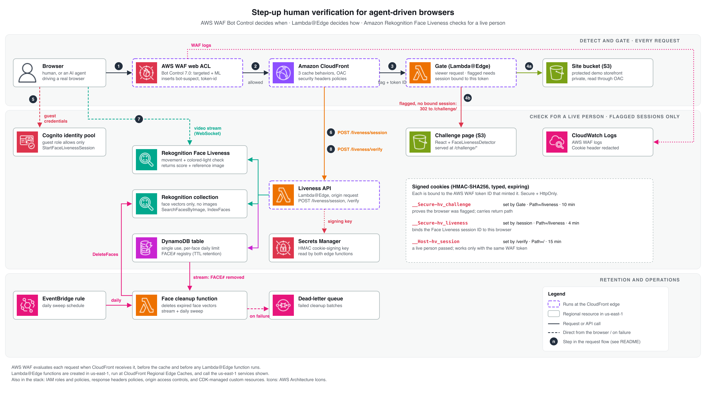
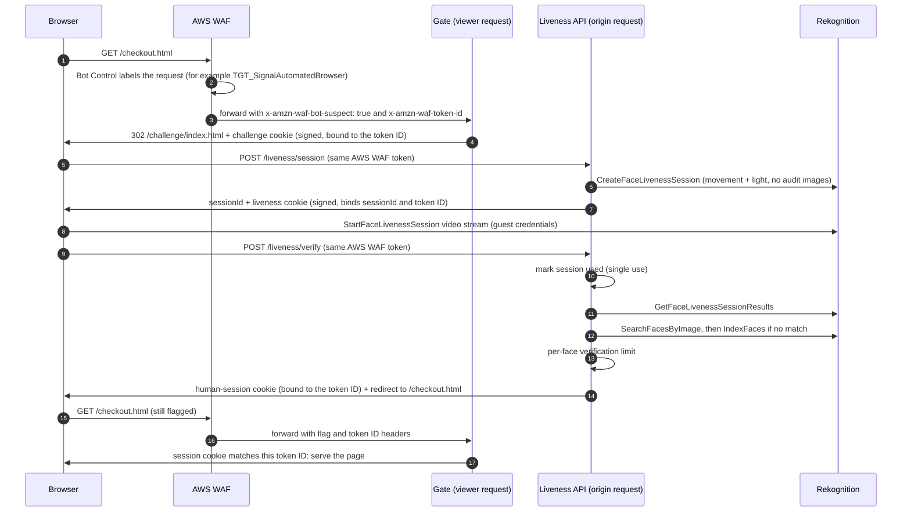

# Mitigating agentic bot threats with Amazon CloudFront and AWS WAF

Step-up human verification for agent-driven browsers with AWS WAF, Lambda@Edge, and Amazon Rekognition Face Liveness.

AI agents can now drive real browsers. They render pages, run JavaScript, solve CAPTCHAs, and pass standard challenge tokens with no human involved. This sample shows a way to respond to that traffic: let **AWS WAF Bot Control** decide *when* a session looks automated, and let **Lambda@Edge** decide *how* to respond. In this sample, the response is an **Amazon Rekognition Face Liveness** check, which an agent can't complete without handing control to a live person in front of a camera.

A face-collection search (`SearchFacesByImage`) then limits how many times the same face can pass the check each day. This raises the cost of sybil attacks, where a few real people clear checks for many agent-controlled sessions. It is a speed bump rather than a hard per-person limit; see [Per-face verification limit](#per-face-verification-limit).

> **Sample code.** This is sample code, for non-production usage. It is not production-ready as is. You should work with your security and legal teams to meet your organizational security, regulatory, and compliance requirements before deployment. Read [Security](#security), [Privacy and biometric data](#privacy-and-biometric-data), and [Limitations](#limitations) before adapting it.

## Architecture



The diagram is generated by `docs/build-diagram.mjs` (run `npm run diagram` from `cdk/`). The Mermaid version below shows the same components.

```mermaid
flowchart LR
  B[Browser] -->|HTTPS| WAF[AWS WAF<br/>Bot Control, targeted]
  WAF -->|"allowed + x-amzn-waf-bot-suspect"| CF[Amazon CloudFront]
  CF --> GATE[Lambda@Edge<br/>viewer request: gate]
  GATE -->|not flagged, or verified| S3S[(S3: demo site)]
  GATE -->|flagged, not verified: 302| CH[(S3: /challenge/ page)]
  CH -.->|POST /liveness/*| LIVE[Lambda@Edge<br/>origin request: liveness API]
  CH -.->|guest credentials| COG[Amazon Cognito<br/>identity pool]
  CH -.->|video stream| REK[Amazon Rekognition<br/>Face Liveness]
  LIVE --> REK
  LIVE --> COL[(Rekognition<br/>face collection)]
  LIVE --> DDB[(DynamoDB)]
  LIVE --> SM[Secrets Manager<br/>signing key]
  GATE --> SM
  DDB -->|stream: registry item removed| CLEAN[Lambda: face cleanup]
  CLEAN --> COL
```

All resources are in **us-east-1**: CloudFront-scoped AWS WAF web ACLs and Lambda@Edge functions must be created there, and Face Liveness is available there. Lambda@Edge functions run at CloudFront Regional Edge Caches and call these us-east-1 services.

| Component | Role |
|---|---|
| AWS WAF web ACL | Bot Control (targeted, with machine learning) labels requests. A custom rule turns automation labels into the `bot-suspect` header, and another forwards the AWS WAF token's session ID in the `token-id` header. |
| `lambda/edge/gate.js` (viewer request) | Passes unflagged requests through untouched. Sends flagged requests to the challenge page unless they carry a valid human-session cookie bound to the same AWS WAF token. |
| `web/challenge` (React, Amplify UI `FaceLivenessDetector`) | Consent screen, then the Face Liveness video check. |
| `lambda/edge/liveness.js` (origin request, `/liveness/*`) | Creates the Face Liveness session, reads the result, runs the sybil check, and issues the human-session cookie. |
| `lambda/edge/lib/sybil-guard.js` | `SearchFacesByImage`, then `IndexFaces` for new faces, then an atomic per-face daily verification limit in DynamoDB. |
| `lambda/face-cleanup` | Deletes face vectors when their retention ends. |

## How it works



### Detection: AWS WAF

| Priority | Rule | Action |
|---|---|---|
| 0 | `BlockSpoofedWafHeaders` | Block requests that already carry an `x-amzn-waf-` header, as the AWS WAF documentation recommends. |
| 1 | `RateLimitLivenessApi` | Block an IP after 10 `/liveness/` calls in 5 minutes (about 5 attempts). |
| 10 | `AWS-BotControl` | `AWSManagedRulesBotControlRuleSet`, pinned to `Version_7.0`, with targeted inspection and machine learning. The rules listed below are overridden to Count, so they only add labels. Other rules keep their managed actions: clear-cut bots are still blocked. `/challenge/` is out of scope. `/liveness/` stays in scope, because AWS WAF only adds the token ID label to requests that Bot Control evaluates. Both path matches (here and in rule 1) use the `URL_DECODE` and `NORMALIZE_PATH` text transformations; see [Path normalization](#path-normalization). |
| 15 | `AcquireWafToken` | Silent Challenge on the first HTML `GET` without an AWS WAF token, so targeted rules have a token to inspect. Verified bots are excluded. |
| 20 | `FlagSuspectedBrowserAgents` | Any escalation label → Count and insert `bot-suspect: true`. |
| 25 | `ForwardWafTokenId` | Requests with an `awswaf:managed:token:id:` label → Count and insert `token-id: ${awswaf:managed:token:id:}` ([dynamic label interpolation](https://docs.aws.amazon.com/waf/latest/developerguide/waf-dynamic-label-interpolation.html)). |
| 30 | `DemoTrigger` (optional) | `?simulate-agent=1` → same header, for testing from a normal browser. |

Rules escalated to Face Liveness instead of CAPTCHA or Block:
`SignalAutomatedBrowser`, `TGT_SignalAutomatedBrowser`, `TGT_SignalBrowserAutomationExtension`, `TGT_SignalBrowserInconsistency`, `TGT_VolumetricSession`, `TGT_TokenReuseIpMedium`, `TGT_ML_CoordinatedActivityMedium`, `TGT_ML_CoordinatedActivityHigh`.
Edit `ESCALATE_TO_LIVENESS_RULES` in `cdk/lib/bot-control-web-acl.ts` to change the list.

#### Why the Bot Control version is pinned

AWS publishes the Bot Control rule group as numbered static versions. If a web ACL doesn't name a version, AWS WAF uses the rule group's default version, and new static versions don't change that default. The default can lack rules this sample depends on: `TGT_SignalBrowserAutomationExtension` and the `TGT_TokenReuse*Low/Medium/High` rules are missing from it. AWS WAF accepts overrides for rules that don't exist in the version, so without a pin those detections would silently never fire.

The version is set with the `botControlVersion` context value. `npm test` checks every escalated rule name against a fixture of the `Version_7.0` rule list (`cdk/test/fixtures/`), taken from `DescribeManagedRuleGroup`. When you move to a newer version, refresh that fixture from the same API.

Static versions expire. To get advance notice, subscribe in us-east-1 to the rule group's SNS topic; `DescribeManagedRuleGroup` returns its ARN. See [Getting notified of new versions and updates](https://docs.aws.amazon.com/waf/latest/developerguide/waf-using-managed-rule-groups-sns-topic.html).

AWS WAF adds the `x-amzn-waf-` prefix to every header it inserts, and CloudFront runs viewer-request Lambda@Edge functions after AWS WAF evaluates the request. That is why the gate reads `x-amzn-waf-bot-suspect` and `x-amzn-waf-token-id`. Rule 0 blocks any client-sent `x-amzn-waf-` header, so a client can't forge either one.

#### Path normalization

CloudFront [normalizes the URI path](https://docs.aws.amazon.com/AmazonCloudFront/latest/DeveloperGuide/DownloadDistValuesCacheBehavior.html#DownloadDistValuesPathPattern) (RFC 3986) to pick a cache behavior, then sends the raw path to the origin. If AWS WAF matched the raw path, `/challenge/../checkout.html` would look like a challenge-page request and skip Bot Control, while CloudFront would route it to the default behavior. An origin that resolves `..` (ALB, EC2, nginx) would then serve the page with no Bot Control labels and no gate check.

Two layers close this:

- Every AWS WAF path match uses `URL_DECODE` then `NORMALIZE_PATH` ([text transformations](https://docs.aws.amazon.com/waf/latest/developerguide/waf-rule-statement-transformation.html)), so AWS WAF scopes rules by the same path CloudFront routes on.
- The gate rejects paths on the default behavior that contain dot segments, empty segments, backslashes, or encoded dots, slashes, or backslashes, with `400 {"error":"invalid_path"}`.

If you add your own path-based AWS WAF rules, use the same transformations.

### Response: Lambda@Edge

The gate does no network calls for unflagged traffic. For flagged traffic it reads the signing key from Secrets Manager (cached per execution environment) and checks the `__Host-hv_session` cookie against the request's AWS WAF token ID.

Only a flagged top-level page load (`GET` or `HEAD` with `Sec-Fetch-Dest: document`, or, from clients that don't send `Sec-Fetch-Dest`, an `Accept` header that asks for `text/html`) is redirected to the challenge and gets a new challenge cookie. Other flagged requests, such as images, scripts, `fetch()` calls, and form posts, get `403 {"error":"human_verification_required"}` with no cookie. The challenge cookie carries the return path, and the gate can't see it (it is scoped to `/liveness`), so letting a favicon or image request mint a new one would send the user to that URL after the check.

Three cookies, each signed with HMAC-SHA256, typed, expiring, and bound to the AWS WAF token ID of the request that minted it:

| Cookie | Set by | Path | SameSite | Lifetime | Purpose |
|---|---|---|---|---|---|
| `__Secure-hv_challenge` | gate | `/liveness` | Strict | 10 min | Only flagged browsers can create liveness sessions. Carries the return path. |
| `__Secure-hv_liveness` | `/liveness/session` | `/liveness` | Strict | 4 min | Binds the Face Liveness session ID to this browser. The client never chooses which session it is verified against. |
| `__Host-hv_session` | `/liveness/verify` | `/` | Lax | 15 min (configurable) | Proof that a live person passed the check, usable only with the same AWS WAF token. |

### Binding the session to the AWS WAF token

Every real browser holds an `aws-waf-token` cookie, and Bot Control tracks it: the `TGT_TokenReuse*` rules fire when one token appears from many IPs, countries, or networks. Without binding, an attacker could pass the face check once and copy only the human-session cookie to many agents, each with its own AWS WAF token. No token would look reused.

AWS WAF token management labels each request it evaluates with `awswaf:managed:token:id:<identifier>`, the token's client session ID ([token labels](https://docs.aws.amazon.com/waf/latest/developerguide/waf-tokens-labeling.html)). Rule 25 forwards it as `x-amzn-waf-token-id`, and:

1. The gate signs it into the challenge cookie.
2. `/liveness/session` requires the request's token ID to match the challenge cookie, and signs it into the liveness cookie.
3. `/liveness/verify` requires a match before it consumes the session, and signs the ID into the human-session cookie.
4. The gate lets a flagged request through only when the human-session cookie's token ID matches the request's.

A missing or different token ID is treated as no session. Copying the human-session cookie to another client therefore means copying its AWS WAF token as well, and that is what the token-reuse rules detect.

Bot Control blocks token reuse only at its High thresholds: more than 8 IPs, or more than 3 countries or networks, within 5 minutes. Below that, a shared cookie and token still work: `TGT_TokenReuseIpMedium` only flags the request, which the bound cookie satisfies, and the Medium country and network rules use CAPTCHA, which agents can solve.

### Per-face verification limit

Face Liveness checks that a live person is in front of the camera. It doesn't check whether that person has verified before. After a successful check, the reference image from `GetFaceLivenessSessionResults` is held in memory and:

1. `SearchFacesByImage` looks for the face in the collection (`faceMatchThreshold`, default 95).
2. If there is no match, `IndexFaces` enrolls it. Rekognition stores a facial feature vector, not the image.
3. A DynamoDB counter, `USAGE#<faceId>#<window>`, is incremented with a conditional update. Once a face has passed `maxVerificationsPerFace` times (default 5) in the current window, further checks return HTTP 429.

This raises the cost of using a few real people to clear checks for many agent sessions. It is not a hard per-person limit:

- **A verified cookie works only with its AWS WAF token.** Sharing the cookie means sharing the token, which Bot Control blocks at its High token-reuse thresholds (see [Binding the session to the AWS WAF token](#binding-the-session-to-the-aws-waf-token)). Below those thresholds, a few clients can share one verification until the cookie expires.
- **One person can enroll more than once.** Two faces count as the same person only at `faceMatchThreshold` similarity or above. A different angle, lighting, or glasses can fall below it and create a second face vector with its own count. Two first-time checks at the same moment can also both enroll.
- **The count resets on a fixed schedule.** Windows are aligned to the Unix epoch, not rolling. With the default 24 hours, every face's count resets at 00:00 UTC, so one face can pass 5 times just before midnight UTC and 5 more just after.

The image is never written to storage or logs, and the face ID is never sent to the browser.

## Prerequisites

- An AWS account and credentials for deployment
- Node.js 22 (or 20.19+)
- AWS CDK v2 CLI, and the account bootstrapped in us-east-1: `npx cdk bootstrap aws://ACCOUNT_ID/us-east-1`
- A device with a camera to test

No Docker is required: Lambda packages are plain JavaScript, and the AWS SDK for JavaScript v3 comes from the Lambda runtime.

## Deploy

```bash
cd cdk
npm ci
npm run build:web     # builds web/challenge into web/challenge/dist
npm test              # Lambda unit tests + infrastructure assertions + cdk-nag
npx cdk diff
npx cdk deploy
```

Outputs:

- `DistributionUrl`: the demo site
- `DemoTriggerUrl`: the site with `?simulate-agent=1`

### Configuration

Set values in `cdk/cdk.json` under `context`, or pass `-c key=value`:

| Key | Default | Meaning |
|---|---|---|
| `prefix` | `agentic-bot-defense` | Prefix for named resources |
| `botControlVersion` | `Version_7.0` | Static version of the Bot Control rule group. Required; see [Why the Bot Control version is pinned](#why-the-bot-control-version-is-pinned) |
| `livenessConfidenceThreshold` | `90` | Minimum Face Liveness confidence to pass. Tune it for your risk tolerance; Rekognition recommends higher thresholds for higher-risk use cases |
| `faceMatchThreshold` | `95` | Minimum similarity to treat two faces as the same person |
| `maxVerificationsPerFace` | `5` | Times one face can pass the check per window |
| `verificationWindowHours` | `24` | Length of each window. Windows are fixed and aligned to the Unix epoch, not rolling; with 24 hours they reset at 00:00 UTC |
| `faceRetentionDays` | `30` | Days a face vector is kept after its last verification |
| `humanSessionMinutes` | `15` | Lifetime of the human-session cookie |
| `enableDemoTrigger` | `true` | Adds the `?simulate-agent=1` rule. **Set to `false` outside demos.** |
| `stackTags` | none | Tags for every resource, as `key=value,key2=value2`. Use this if your account runs automated cleanup that deletes untagged resources; a deleted table or function breaks the flow until you redeploy |

## Test it

Run the post-deploy smoke test first. It needs no camera or browser, and it creates no Face Liveness session. It checks that AWS WAF is attached, that a client can't forge the token-ID header, that flagged page loads reach the challenge, that flagged subresources get a 403 without a challenge cookie, that a `/challenge/../` path is still in Bot Control's scope and is rejected by the gate, and the challenge page headers. It also checks that the liveness API refuses requests without the challenge cookie or an AWS WAF token. The script can't hold an AWS WAF token, so it can't run the full flow; Bot Control may answer its API calls with a challenge, which also counts as a pass. Wait 5 minutes between runs:

```bash
cd cdk
npm run smoke -- https://<distribution-domain>
```

Then test the full flow with a camera:

1. Open `DistributionUrl`. The page loads normally. Your first visit may briefly show the AWS WAF silent challenge.
2. Open `DemoTriggerUrl`. AWS WAF flags the request and you are redirected to `/challenge/index.html`.
3. Choose **Start the check**, allow camera access, and follow the prompts.
4. You are returned to the page you requested. For 15 minutes, flagged requests from this browser pass.
5. Pass the check more than 5 times in the same UTC day with the same face. Verification returns "Too many verification attempts".
6. Copy the `__Host-hv_session` cookie into a different browser profile and open `DemoTriggerUrl` there. That profile has its own AWS WAF token, so it is sent to the challenge.

To see real detections, drive the site with a browser automation framework. Some Bot Control rules need time to take effect: volumetric rules can take about 5 minutes, and the machine learning rules can take up to 24 hours to build baselines.

Useful signals:

- AWS WAF logs: CloudWatch Logs group `aws-waf-logs-<prefix>`. Look for `FlagSuspectedBrowserAgents` in `nonTerminatingMatchingRules`. The `cookie` header is redacted.
- Lambda@Edge logs: CloudWatch Logs in the Region nearest the viewer, in the log group `/aws/lambda/us-east-1.<function-name>`. Events: `challenge_issued` (with `reason`: `no_session`, `waf_token_mismatch`, or `waf_token_missing`), `verification_required` (a flagged request that isn't a page load, same `reason` values), `invalid_path_rejected`, `waf_token_mismatch`, `liveness_result` (with the score, server-side only), `sybil_decision`. Token IDs and cookie values are never logged.

## Adapting the pattern

Detection and response are separate, so either side can change on its own:

- **Different detection**: change `ESCALATE_TO_LIVENESS_RULES`, or add any AWS WAF rule that inserts `bot-suspect: true` (rate-based rules, AWS WAF Fraud Control labels, IP reputation).
- **Different challenge**: replace `liveness.js` and the challenge page with another check that an agent can't complete alone, such as WebAuthn attestation with a hardware key. Keep the gate and cookie contract as they are.
- **SPAs and mobile apps**: use the AWS WAF client application integration SDKs to acquire tokens instead of the `AcquireWafToken` rule. When an API call gets the gate's `403 {"error":"human_verification_required"}`, reload or navigate the top-level page (for example `location.reload()`). The gate answers that page load with the challenge redirect and returns the user to that page afterwards.

## Security

- **Fail closed.** If the signing key can't be loaded, flagged requests get 503. They are never let through.
- **No client trust.** The session ID being verified comes from a signed HttpOnly cookie, not the request body. The return path is signed into the challenge cookie and checked again as a same-origin relative path. Only top-level page loads can set it.
- **Path normalization.** AWS WAF path matches use `URL_DECODE` and `NORMALIZE_PATH`, and the gate rejects non-normalized paths, so `..` can't move a request out of Bot Control's scope.
- **Single use.** Each Face Liveness session can mint only one human session (a conditional `PutItem` on `SESSION#<id>`).
- **Token binding.** Every cookie is bound to the AWS WAF token ID that AWS WAF forwards, and only AWS WAF can set that header.
- **Score never leaves the server.** The browser gets pass or fail only, as Rekognition recommends.
- **CSRF.** The liveness API accepts only `POST` with `Content-Type: application/json`. It rejects `Sec-Fetch-Site` values other than `same-origin`, and its cookies are `SameSite=Strict`.
- **Least privilege.**
  - The guest role can call `rekognition:StartFaceLivenessSession` only.
  - Face search and enrollment permissions are scoped to the collection ARN.
  - Session creation and result retrieval happen only in the liveness function.
- **No secrets in packages.** Lambda@Edge doesn't support environment variables, so CDK writes resource names and thresholds into `config.json` at synth time. The HMAC key stays in Secrets Manager.
- **Private origins.** Both buckets block all public access and are read through CloudFront origin access control (OAC). Bucket policies deny non-TLS access.
- **Headers.** The challenge page gets a restrictive CSP that allows only Cognito Identity, the Rekognition streaming endpoint, and the Face Liveness model CDN. It also gets `Permissions-Policy: camera=(self)`, HSTS, `X-Frame-Options: DENY`, and `nosniff`.
- **cdk-nag.** `npm test` fails on any unacknowledged AwsSolutions finding. Each acknowledgement is scoped to a specific resource and states its reason (`cdk/lib/agentic-bot-defense-stack.ts`).

Before production:

- Use a custom domain with an ACM certificate and `TLSv1.2_2021`.
- Enable CloudFront and S3 access logging.
- Disable `enableDemoTrigger`.
- Rotate the signing key: store `{current, previous}` in the secret, sign with `current`, and verify against both.

## Privacy and biometric data

Face Liveness and face search process biometric data, which many jurisdictions regulate. You are responsible for giving end users legally adequate privacy notices and getting any necessary consent. See the [Face Liveness shared responsibility model](https://docs.aws.amazon.com/rekognition/latest/dg/face-liveness-shared-responsibility-model.html). This sample is built to collect as little as possible:

- A consent screen comes before the camera starts and states the retention period.
- `AuditImagesLimit` is 0, and the reference image is never stored.
- Face vectors are deleted when their DynamoDB registry item expires (`faceRetentionDays` after the last verification) or is deleted. A daily sweep removes any face whose registry item is missing or expired. This covers DynamoDB TTL deleting items in the background after expiry, and covers rare orphaned faces.
- To honor an erasure request, delete the `FACE#<faceId>` item. The stream-triggered cleanup function deletes the vector.
- `cdk destroy` deletes the collection and every face in it.

Rekognition recommends offering an alternative verification path for users who are photosensitive or don't want a face check. The challenge page has a placeholder for it; wire it to your support process.

## Limitations

- **Relay.** An agent can forward the challenge to a remote person. The per-face limit reduces how many sessions each person can clear, within the caveats in [Per-face verification limit](#per-face-verification-limit). It does not stop relay.
- **Cookie sharing.** The human-session cookie only works with its AWS WAF token, and Bot Control blocks token reuse at its High thresholds. Below them, a few clients can share one verification for the cookie's lifetime. To close that gap, treat the `TGT_TokenReuse*Medium` labels as a reason to re-verify even with a valid cookie.
- **Token ID changes.** If a browser discards its AWS WAF token and gets a new one, its token ID changes and it has to pass the face check again. That is safe but adds friction.
- **Single home Region.** Flagged sessions depend on us-east-1 (Secrets Manager, DynamoDB, Rekognition). Unflagged traffic does not.
- **Cost.** The viewer-request function runs on every request to the default behavior. Bot Control targeted inspection, Face Liveness checks, and stored face vectors are billed separately. See [AWS WAF pricing](https://aws.amazon.com/waf/pricing/), [Amazon Rekognition pricing](https://aws.amazon.com/rekognition/pricing/), and [CloudFront pricing](https://aws.amazon.com/cloudfront/pricing/).

## Project structure

```
cdk/
  bin/app.ts                       CDK app, context validation, cdk-nag
  lib/agentic-bot-defense-stack.ts Stack: state, Lambda@Edge, CloudFront, cleanup
  lib/bot-control-web-acl.ts       AWS WAF web ACL and logging
  lambda/edge/gate.js              Viewer request: escalate flagged sessions
  lambda/edge/liveness.js          Origin request: Face Liveness API
  lambda/edge/lib/                 Tokens, cookies, signing key, sybil guard
  lambda/face-cleanup/index.js     Face-vector retention
  test/                            node:test unit tests and CDK assertions
  scripts/smoke-test.mjs           post-deploy smoke test (no camera needed)
docs/
  architecture.png, .svg           architecture diagram
  build-diagram.mjs                diagram generator
  icons/                           AWS Architecture Icons used by the diagram
web/
  challenge/                       React + Amplify UI FaceLivenessDetector
  site/                            Static demo storefront
```

## Cleanup

```bash
cd cdk
npx cdk destroy
```

Lambda@Edge replicas are deleted asynchronously after the distribution is removed, so the first `destroy` can fail on the edge functions. Wait a few hours and run it again.

## Security issue notifications

See [CONTRIBUTING](CONTRIBUTING.md#security-issue-notifications).

## License

This library is licensed under the MIT-0 License. See the [LICENSE](LICENSE) file.

The architecture diagram uses AWS Architecture Icons, obtained through a third-party MIT-licensed package. See [THIRD-PARTY-LICENSES](THIRD-PARTY-LICENSES).
